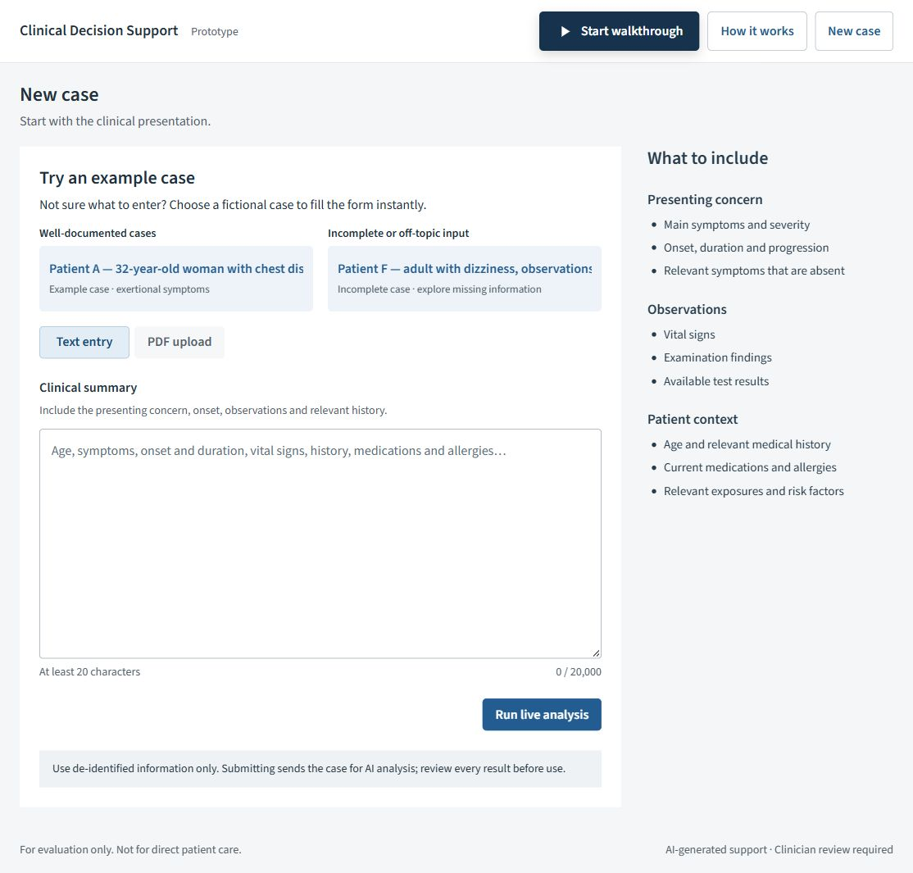
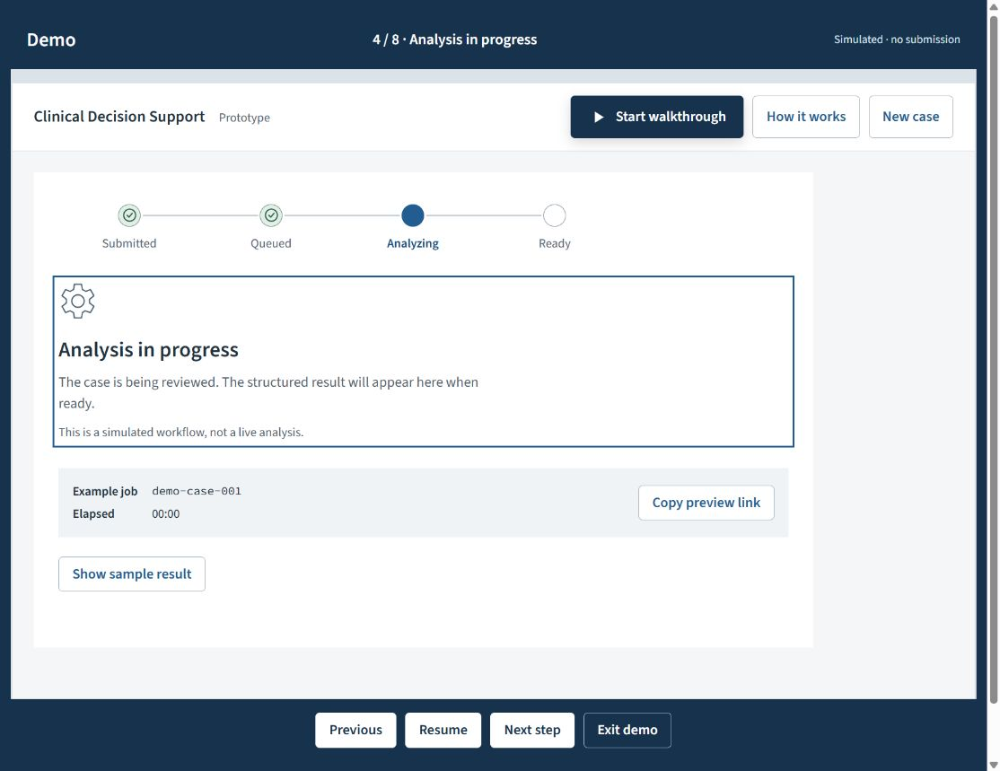
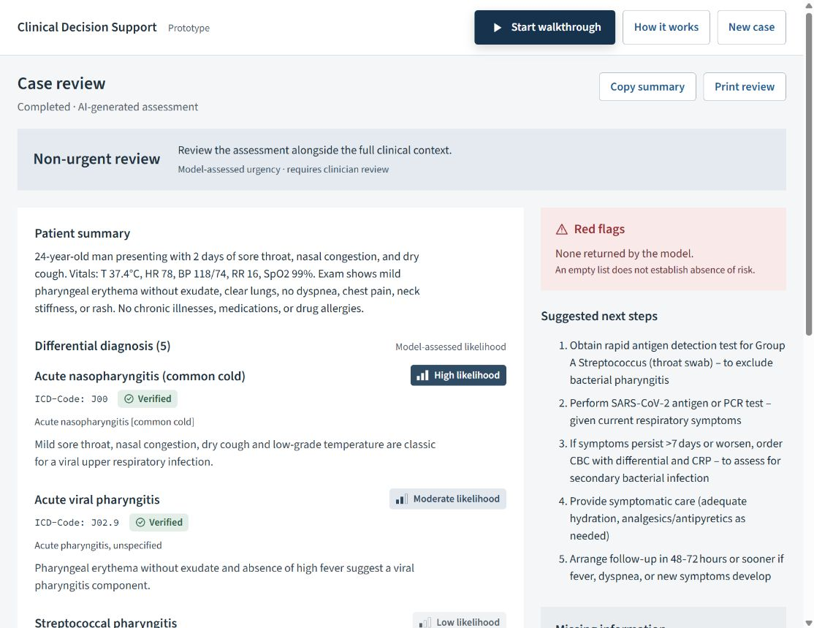

# [Clinical Decision Support](https://clinical-decision-support-system-1cqq.onrender.com/)

**[Open the live demo →](https://clinical-decision-support-system-1cqq.onrender.com/)** · Choose an example case or start the guided walkthrough.

## Background and motivation

A referral note can contain everything a receiving clinician needs, spread across a dense narrative. I built this prototype to turn that summary into a structured review of possible conditions, urgency, red flags, next steps, and missing information.

The project brings together a web interface, asynchronous processing, AI analysis, and terminology verification. It is an evaluation prototype for clinical reasoning and has not been clinically validated.

### Start with a patient case

Type a summary, upload a clinical PDF, or try a short example. Well-documented, incomplete, and off-topic inputs show how the application handles different submissions.

### Follow the analysis

The guided demo shows the case moving from submission through the queue to analysis. Live submissions display startup activity and elapsed time while the hosted services prepare.

### Review the result

Compare the differential and its reasoning alongside red flags, suggested next steps, and missing information. Verified badges link to National Library of Medicine health information.

[View all screen captures](docs/screens.md) · [Try the application](https://clinical-decision-support-system-1cqq.onrender.com/)

## Tech stack

| Area | Technologies |
| --- | --- |
| Interface | HTML, CSS, JavaScript |
| API and background processing | Python, FastAPI, Celery, Upstash Redis |
| AI and terminology | Groq, NLM ICD-10-CM API |
| Database and files | Supabase Postgres, SQLAlchemy, Supabase Storage, pdfplumber |
| Delivery and testing | Docker, Render, Alembic, uv, pytest, Node.js test runner |

## Documentation

[Technical guide](docs/technical-guide.md) covers architecture, API endpoints, setup, deployment, troubleshooting, and tests. [Project background](docs/background.md), [product notes](docs/PRODUCT.md), and the [design system](docs/DESIGN.md) provide further context. Earlier design reviews are in [docs/design-review](docs/design-review).
