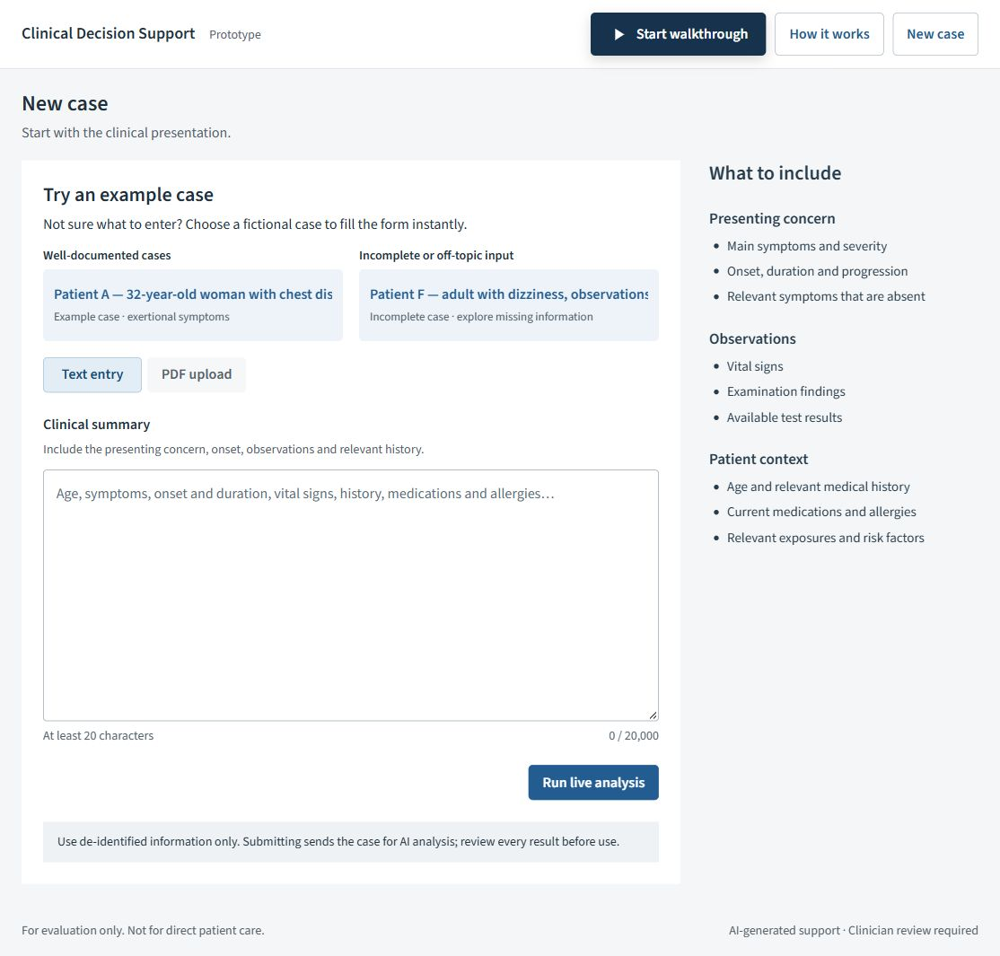
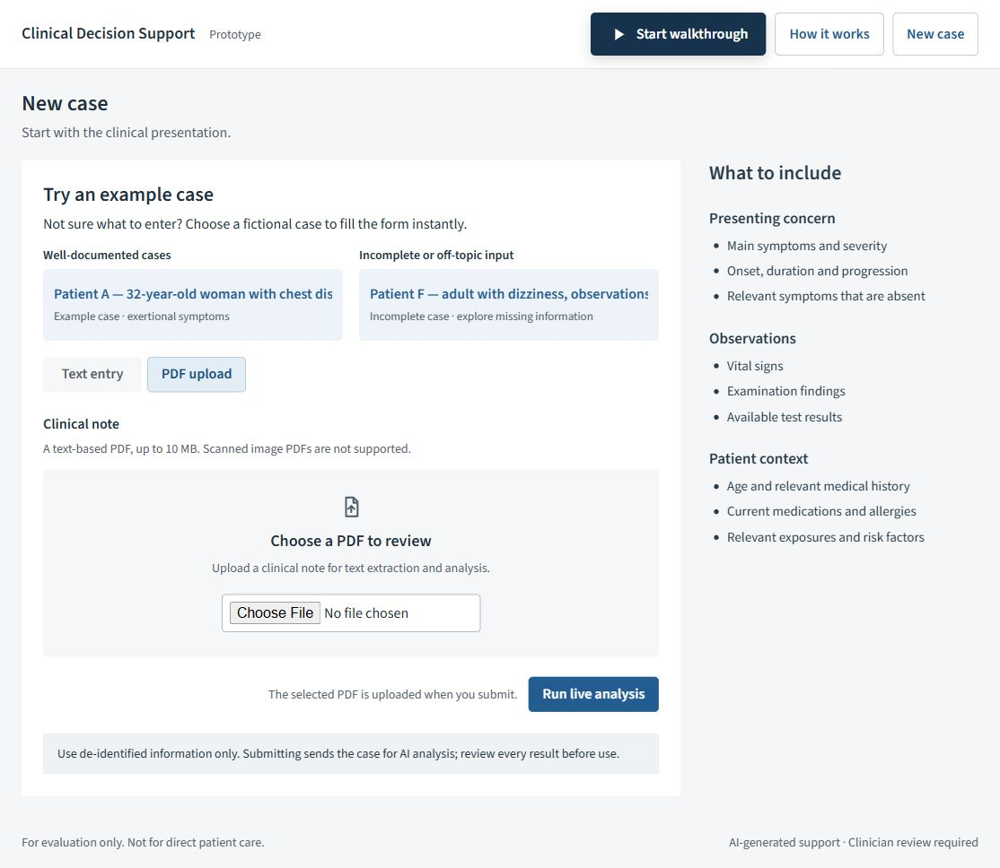
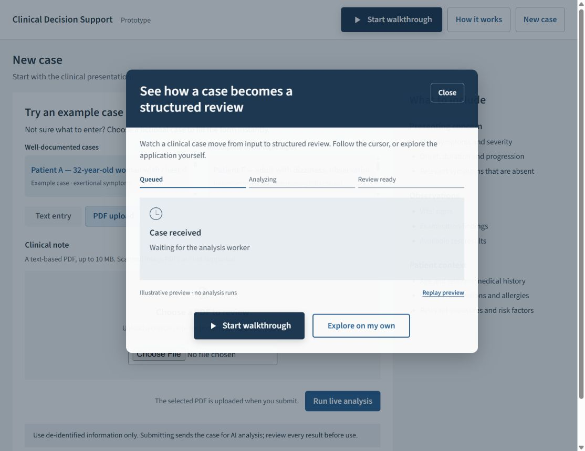
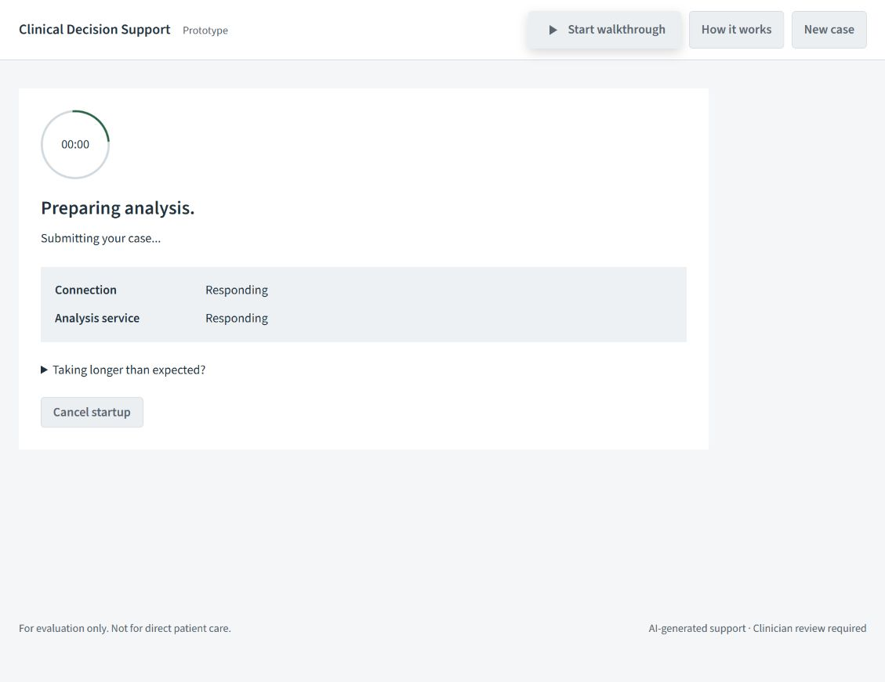
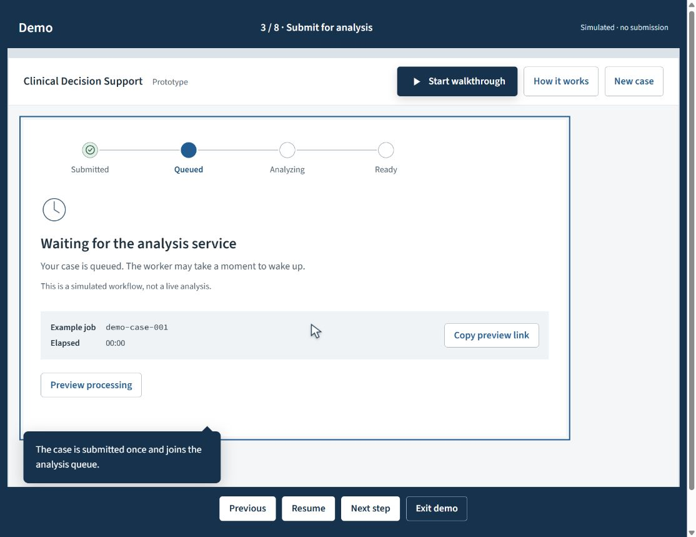
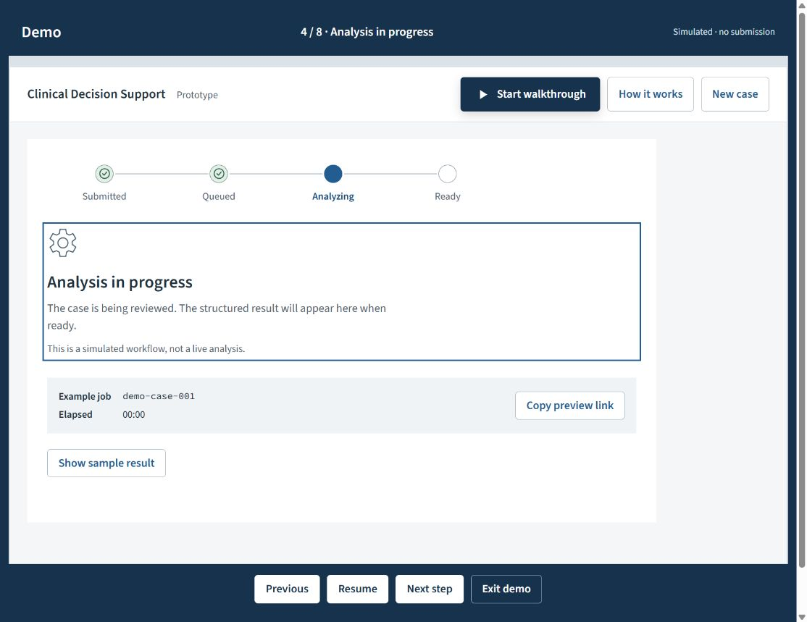
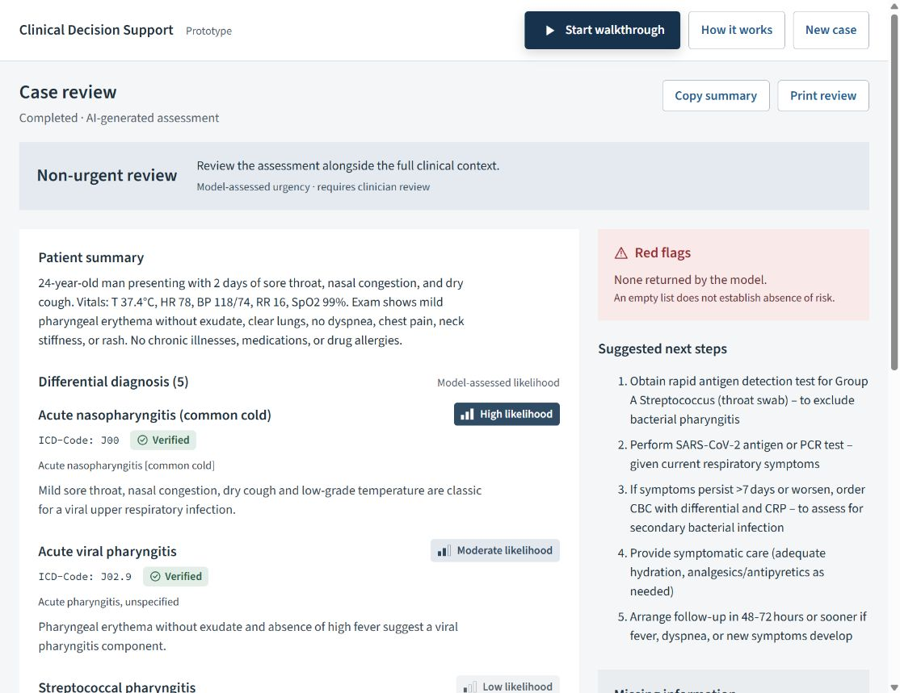

# Application screens

[Open the live demo](https://clinical-decision-support-system-1cqq.onrender.com/) · [Project overview](../README.md)

These browser captures use synthetic cases. Queue and processing captures come from the built-in simulated walkthrough. The result capture comes from a completed live analysis.

## Case entry

## PDF upload

## Walkthrough invitation

## Preparing analysis

## Queued

## Analyzing

## Results

